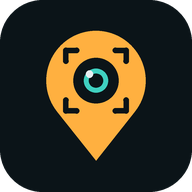
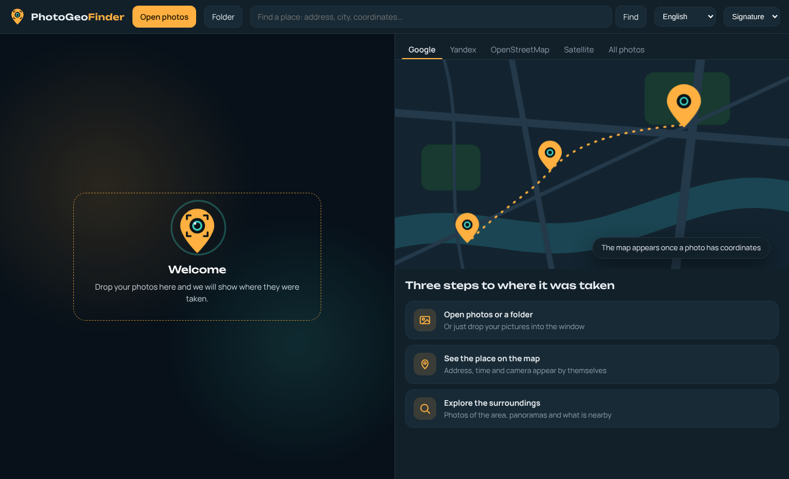

<h1 align="center">FotoGeoBuscador (PhotoGeoFinder)</h1>

<b>Foto. Lugar. Todo alrededor.</b>

<a href="README.md">English</a> · <a href="README.ru.md">Русский</a> · <a href="README.de.md">Deutsch</a> · <a href="README.es.md">Español</a> · <a href="README.fr.md">Français</a> · <a href="README.pt.md">Português</a> · <a href="README.tr.md">Türkçe</a> · <a href="README.zh-CN.md">中文</a> · <a href="README.ja.md">日本語</a> · <a href="README.ko.md">한국어</a> · <a href="README.hi.md">हिन्दी</a> · <a href="README.id.md">Bahasa Indonesia</a> · <a href="README.vi.md">Tiếng Việt</a> · <a href="README.th.md">ไทย</a> · <a href="README.ar.md">العربية</a>

Visor de fotos gratuito y privado que muestra **dónde se tomó una foto**. Lee el GPS de los datos EXIF y muestra el lugar en Google Maps, Yandex Maps y OpenStreetMap a la vez, con la dirección, la hora, la cámara, fotos de la zona y artículos de Wikipedia cercanos.

## Funciones

- **Tus fotos se quedan contigo.** No se suben a ningún servidor y se leen en tu propio dispositivo. Sin cuenta, sin anuncios, sin seguimiento.
- **El lugar de la foto en el mapa.** Google, Yandex, OpenStreetMap y satélite en una sola ventana.
- **Dirección** y coordenadas de cada foto, y enlaces a panorámicas de calles.
- **Fotos de la zona de otras personas** y una ficha de Wikipedia sobre lo que hay cerca.
- **Todas las fotos en un mapa** y la ruta de tu viaje.
- **Hora y cámara** de la toma junto a las coordenadas.
- **Búsqueda de lugar** para fotos sin coordenadas.
- **Se instala como programa** y funciona sin internet.

## Privacidad

Las fotos se abren y se leen en tu navegador y nunca se suben. A los servicios de mapas, direcciones y Wikipedia solo van las coordenadas del punto. Sin cuenta, sin anuncios, sin analítica.

## Instalación

- En línea: abre https://ildargiv.github.io/photogeofinder/ en Chrome o Edge y pulsa «Instalar programa». Las actualizaciones llegan solas.
- Copia local: descarga el zip más reciente de [Releases](https://github.com/ildargiv/photogeofinder/releases/latest), descomprímelo y ejecuta `start-windows.bat` (Windows, requiere Python) o `start-mac-linux.command`. La app avisa cuando hay una versión nueva.

## Idiomas

Русский, English, Deutsch, Español, Français, Português, Türkçe, 中文, 日本語, 한국어, हिन्दी, Bahasa Indonesia, Tiếng Việt, ไทย, العربية

## Licencia

MIT. Componentes de terceros: [THIRD_PARTY_NOTICES.md](THIRD_PARTY_NOTICES.md).
